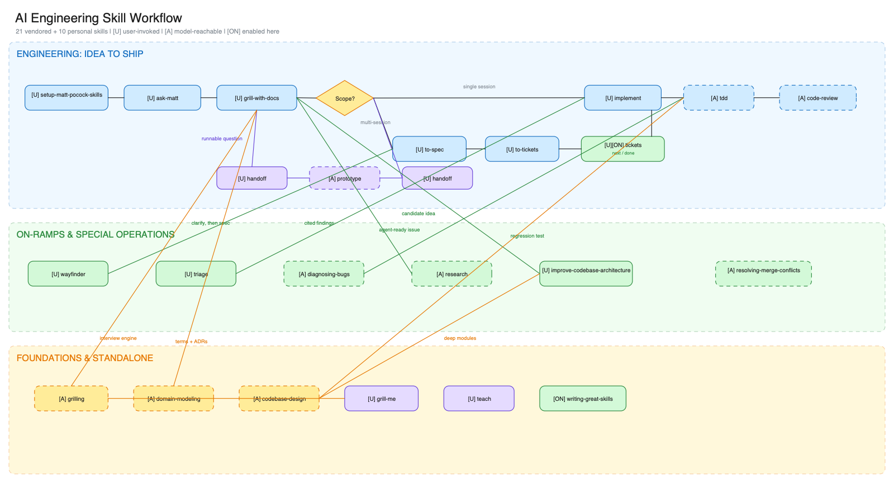

# peibin-skills

[English](./README.md) | [简体中文](./README.zh-CN.md)

A curated collection of reusable AI coding-agent skills and engineering workflows for Codex, Claude Code, and Cursor.

The repository separates ownership clearly:

- `skills/personal/` contains skills maintained in this repository.
- `skills/vendor/` contains selected third-party skills pinned to a recorded upstream revision.
- [`.claude-plugin/plugin.json`](./.claude-plugin/plugin.json) defines the skills enabled by the Claude Code plugin.

## Engineering Workflow

The core delivery loop keeps requirements, planning, implementation, ticket state, commits, and pull requests as separate responsibilities:

```text
$requirements-analysis
        |
        v
$to-spec -> $to-tickets
                 |
                 v
          $tickets next
                 |
                 v
            $implement
                 |
                 v
          $tickets done
                 |
                 v
           $to-commits -> $to-pr
```

`$tickets` manages the configured local Markdown or GitHub Issue ticket DAG. It does not implement or verify product work; `$implement` owns implementation, tests, review, and implementation commits.

[](./docs/diagrams/skill-workflow.excalidraw)

[Edit the Excalidraw source](./docs/diagrams/skill-workflow.excalidraw) · [View the SVG](./docs/diagrams/skill-workflow.svg)

## Personal Skills

| Skill | Purpose | Use it when |
|---|---|---|
| [to-commits](./skills/personal/to-commits/) | Split uncommitted work into focused Conventional Commits | Changes are ready to commit |
| [to-pr](./skills/personal/to-pr/) | Build a PR description from committed changes and open it | A branch is ready for review |
| [to-mermaid](./skills/personal/to-mermaid/) | Produce Mermaid diagrams that render reliably in Markdown | Paths or special characters make diagrams fragile |
| [to-feature-doc](./skills/personal/to-feature-doc/) | Document an existing feature from its implementation | A module needs an engineering or onboarding guide |
| [explain-feature](./skills/personal/explain-feature/) | Explain delivered behavior and implementation across tickets in plain language | You want to understand what a feature does and how it works |
| [requirements-analysis](./skills/personal/requirements-analysis/) | Clarify a feature one decision at a time and preserve the discussion | Requirements are still ambiguous |
| [setup-engineering-workflow](./skills/personal/setup-engineering-workflow/) | Configure workflows and project instructions from actual commands, module boundaries, and constraints | A repository is adopting the workflow |
| [tickets](./skills/personal/tickets/) | Manage a local Markdown or GitHub Issue ticket DAG | Tickets need to be inspected, activated, completed, or paused |
| [implement](./skills/personal/implement/) | Implement a spec or ticket in its configured worktree | A planned piece of work is ready to build |
| [blueprint](./skills/personal/blueprint/) | Draw a detailed architecture diagram for a feature across layers, with a short caption | A feature needs a whole-system blueprint diagram |
| [handoff](./skills/personal/handoff/) | Use `$handoff` to create a durable, versioned Markdown handoff | Work must continue in another session |
| [code-review](./skills/personal/code-review/) | Review a scoped change for concrete, evidence-backed regressions | Daily local changes, commits, branches, or PRs need review |
| [html-to-mobile-page](./skills/personal/html-to-mobile-page/) | Design and implement native mobile pages from HTML prototypes, preserving functionality | An HTML reference needs a native mobile implementation |
| [init-flutter-app](./skills/personal/flutter/init-flutter-app/) | Scaffold a Flutter app from `flutter-template` | Starting a Flutter project |
| [add-flutter-feature](./skills/personal/flutter/add-flutter-feature/) | Add a layered feature to a `flutter-template` project | Extending an existing Flutter app |
| [android-app-monitor](./skills/personal/android-app-monitor/) | Collect Android memory, CPU, frames, logs, and operation markers through ADB | Investigating app performance during manual use |

`setup-engineering-workflow` is adapted from `setup-matt-pocock-skills` in [mattpocock/skills](https://github.com/mattpocock/skills), revision `2ab958093e83e0ec752e6c1c5932da465bf23e0c`. It retains the upstream MIT license and adds configuration for feature documents and worktrees.

## Vendor Skills

The vendored [Matt Pocock skills](./skills/vendor/mattpocock/) are kept as a selective local fork. The source revision is recorded in [`SOURCE.json`](./skills/vendor/mattpocock/SOURCE.json), and the upstream MIT license is preserved alongside it.

The plugin currently enables the vendored workflow stages `grill-with-docs`, `to-spec`, `to-tickets`, and `tdd`, plus the maintained personal `implement` and `code-review` skills. It also enables the other personal workflow skills and the `writing-great-skills`, `grilling`, and `domain-modeling` dependencies. Other vendored skills remain available as source but are not loaded by default.

Both personal and vendor collections contain skills named `handoff` and `code-review`. The personal versions are canonical and are the only copies registered in the plugin; the vendor versions are retained as reference source.

`$handoff` creates a full handoff by default. Use `$handoff --compact` for frequent continuation; both profiles support artifact-only output through `$handoff --artifact-only` and `$handoff --compact --artifact-only`.

## Installation

Clone the private repository with configured GitHub SSH credentials:

```bash
git clone git@github.com:ZhangPeibin/peibin-skills.git
cd peibin-skills
```

### Codex

Copy or symlink the personal skills you need into the shared agent skills directory:

```bash
mkdir -p ~/.agents/skills
for src in \
  to-commits to-pr to-mermaid to-feature-doc explain-feature \
  requirements-analysis setup-engineering-workflow tickets implement blueprint \
  handoff code-review html-to-mobile-page \
  flutter/init-flutter-app flutter/add-flutter-feature android-app-monitor
do
  ln -s "/path/to/peibin-skills/skills/personal/$src" ~/.agents/skills/"$(basename "$src")"
done
```

### Claude Code Plugin

Load the repository as a Claude Code plugin through [`.claude-plugin/plugin.json`](./.claude-plugin/plugin.json) to enable every registered skill together.

### Cursor

Copy or symlink the personal skills you need into the Cursor skills directory:

```bash
mkdir -p ~/.cursor/skills
for src in \
  to-commits to-pr to-mermaid to-feature-doc explain-feature \
  requirements-analysis setup-engineering-workflow tickets implement blueprint \
  handoff code-review html-to-mobile-page \
  flutter/init-flutter-app flutter/add-flutter-feature android-app-monitor
do
  ln -s "/path/to/peibin-skills/skills/personal/$src" ~/.cursor/skills/"$(basename "$src")"
done
```

### `npx skills`

Install the canonical personal `handoff` and `code-review` directly so name deduplication cannot select the vendored copies:

```bash
npx skills add /path/to/peibin-skills/skills/personal/handoff --agent codex --copy -y
npx skills add /path/to/peibin-skills/skills/personal/code-review --agent codex --copy -y
```

Do not install `handoff` or `code-review` through repository-root `--full-depth` discovery. The installer deduplicates skills by name, so its list does not prove which copy was selected. Root discovery remains suitable for explicitly named skills without collisions.

Install the main workflow and its dependencies:

```bash
npx skills add /path/to/peibin-skills --full-depth --skill setup-engineering-workflow requirements-analysis grill-with-docs to-spec to-tickets implement tdd grilling domain-modeling
```

The installer may create or update `skills-lock.json` in the consuming project; this source repository does not maintain that lock file.

## Development

Run the same isolated checks used by CI:

```bash
uv run --isolated --no-project --no-config --no-env-file --with PyYAML==6.0.2 -- python3 -I scripts/check.py
```

The check validates plugin registration, Skill metadata, local documentation links, workflow assets, and every personal Skill test suite. A local `make check` runs the same entrypoint directly.

## Repository Layout

```text
peibin-skills/
├── .claude-plugin/
│   └── plugin.json
├── .github/workflows/ci.yml
├── docs/diagrams/
├── scripts/check.py
├── scripts/validate_repo.py
├── skills/
│   ├── personal/
│   └── vendor/mattpocock/
├── README.md
├── README.zh-CN.md
└── Makefile
```

## Adding a Skill

1. Create a directory under `skills/personal/`, such as `skills/personal/my-skill/`.
2. Add `SKILL.md` with `name` and `description` frontmatter.
3. Add `agents/openai.yaml`; explicitly invoked skills should set `allow_implicit_invocation: false`.
4. Register the path in [`.claude-plugin/plugin.json`](./.claude-plugin/plugin.json).
5. Update both README files.

Place third-party skills under `skills/vendor/<owner>/`, preserve their license, and record the upstream repository and exact revision.

## License

[MIT](./LICENSE)
