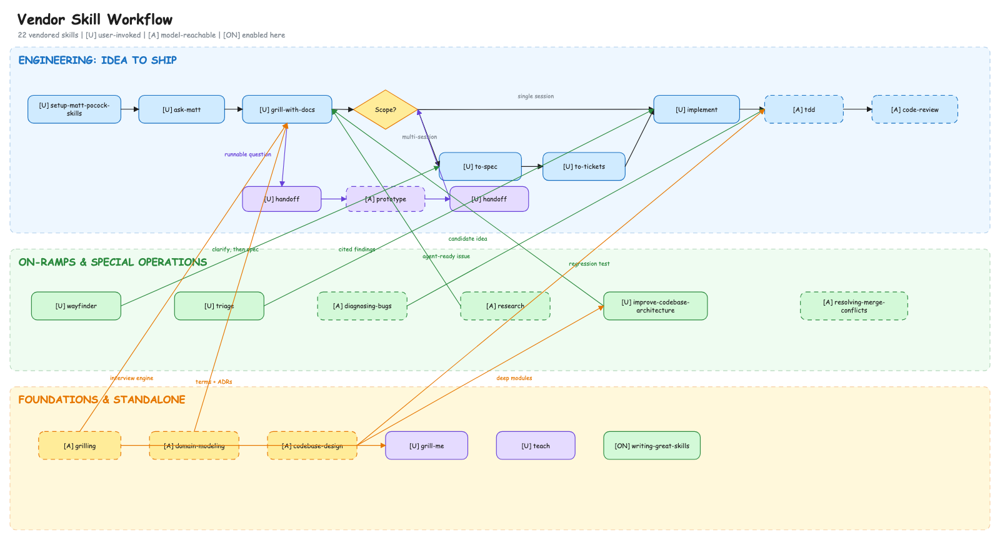

# peibin-skills

个人维护和精选的 AI Agent Skills 集合，用于 Cursor / Claude Code 等支持 Skills 的编码助手。

仓库按所有权区分 Skill：`skills/personal/` 是自己维护的内容，`skills/vendor/` 是从第三方仓库收录的内容。

## Personal Skills

| Skill | 说明 | 触发场景 |
|-------|------|----------|
| [to-commits](./skills/personal/to-commits/) | 按逻辑关注点把未提交改动拆成多个 Conventional Commits | 准备提交、希望按改动类型拆 commit |
| [to-pr](./skills/personal/to-pr/) | 基于当前分支相对 base 的 commits/diff 写 PR 描述并创建 PR | 分支已有 commits、要开 pull request |
| [to-mermaid](./skills/personal/to-mermaid/) | 写出能在 Markdown 里正确渲染的 Mermaid 图 | 画 flowchart / sequence 等，尤其标签含路径或特殊字符 |
| [to-feature-doc](./skills/personal/to-feature-doc/) | 基于真实代码为现有功能模块生成新人 onboarding 文档 | 需要为某个功能/模块写设计说明文档 |
| [requirements-analysis](./skills/personal/requirements-analysis/) | 通过逐项追问澄清 Feature，并持续维护 pre-PRD 讨论文档 | 需求尚未清晰、需要保留讨论和决策上下文 |
| [setup-engineering-workflow](./skills/personal/setup-engineering-workflow/) | 为工程 Skill 配置 issue tracker、标签、领域文档和 pre-PRD Feature 文档 | 首次在仓库中使用开发工作流 |
| [tickets](./skills/personal/tickets/) | 管理 `to-tickets` 生成的本地 ticket DAG 状态，不实现或验证产品代码 | 查看队列、领取、显式完成或暂停 ticket |
| [handoff](./skills/personal/handoff/) | 把当前会话压缩成可恢复、可验证的版本化 Markdown 交接物 | 用户显式调用 `$handoff`，或编排器显式请求 artifact-only 交接 |
| [init-flutter-app](./skills/personal/flutter/init-flutter-app/) | 从 flutter-template（GitHub 或本地）脚手架新 Flutter 应用 | 要用模板初始化 Flutter 项目 |
| [add-flutter-feature](./skills/personal/flutter/add-flutter-feature/) | 在 flutter-template 派生项目里按规范新增一个 feature（生成器 + playbook + make check） | 要给这类 Flutter 项目加功能 |

`setup-engineering-workflow` 基于 [mattpocock/skills](https://github.com/mattpocock/skills) 的 `setup-matt-pocock-skills`（revision `2ab958093e83e0ec752e6c1c5932da465bf23e0c`）改造，保留原 MIT 许可，并增加了 `requirements-analysis` 所需的 Feature Docs 配置。

## Vendor Skills

[Matt Pocock Skills](./skills/vendor/mattpocock/) 来自本地 fork，当前筛选保留 21 个 Skill。来源版本记录在 [`SOURCE.json`](./skills/vendor/mattpocock/SOURCE.json)，原 MIT 许可证保存在同一目录。

vendor 内容默认不随插件加载。目前启用了 [`writing-great-skills`](./skills/vendor/mattpocock/productivity/writing-great-skills/)，以及由 `grill-with-docs`、`to-spec`、`to-tickets`、`implement`、`tdd`、`code-review` 组成的开发主流程。主流程同时启用 personal 的 `setup-engineering-workflow` 和 `requirements-analysis`，以及 `grill-with-docs` 依赖的 `grilling` 和 `domain-modeling`；其他 Skill 保留源码，等实际需要时再逐个加入插件清单。

personal 与 vendor 源码中各有一个名为 `handoff` 的 Skill。personal 版本是本仓库的 canonical 版本；vendor `handoff` 仅作为参考源码，不随 Claude Code 插件加载。

`handoff` 默认生成完整交接；高频续接可用 `$handoff --compact`。两种内容档位都支持只返回 Markdown：`$handoff --artifact-only` 与 `$handoff --compact --artifact-only`。

### Workflow

蓝色区域是从想法到交付的主流程；绿色区域是问题、调研和架构改进等入口；黄色区域提供贯穿流程的设计方法和独立工具。`[U]` 表示需要用户主动调用，`[A]` 表示模型也可以主动调用，`[ON]` 表示当前已在本仓库插件中启用。

[](./docs/diagrams/vendor-skill-workflow.excalidraw)

[Excalidraw 可编辑源文件](./docs/diagrams/vendor-skill-workflow.excalidraw) · [SVG 预览](./docs/diagrams/vendor-skill-workflow.svg)

### Skill 说明

| Skill | 用途 |
|-------|------|
| [`ask-matt`](./skills/vendor/mattpocock/engineering/ask-matt/) | 工作流入口：根据当前问题推荐合适的 Skill 或组合流程。 |
| [`grill-with-docs`](./skills/vendor/mattpocock/engineering/grill-with-docs/) | 通过连续追问澄清设计，并把术语和决策写入项目文档。 |
| [`wayfinder`](./skills/vendor/mattpocock/engineering/wayfinder/) | 为跨多个会话的大型工作建立决策地图。 |
| [`to-spec`](./skills/vendor/mattpocock/engineering/to-spec/) | 把已经讨论清楚的需求整理成可发布的规格说明。 |
| [`to-tickets`](./skills/vendor/mattpocock/engineering/to-tickets/) | 把规格拆成有依赖关系、可独立领取的任务。 |
| [`implement`](./skills/vendor/mattpocock/engineering/implement/) | 按规格或任务实施，并组织 TDD、审查和提交前检查。 |
| [`tdd`](./skills/vendor/mattpocock/engineering/tdd/) | 使用 red-green-refactor 循环逐个交付行为。 |
| [`code-review`](./skills/vendor/mattpocock/engineering/code-review/) | 同时从代码规范和需求符合度两个方向审查改动。 |
| [`diagnosing-bugs`](./skills/vendor/mattpocock/engineering/diagnosing-bugs/) | 从可复现的红色反馈循环出发，定位并修复疑难问题。 |
| [`resolving-merge-conflicts`](./skills/vendor/mattpocock/engineering/resolving-merge-conflicts/) | 根据两侧改动意图逐个解决 merge 或 rebase 冲突。 |
| [`triage`](./skills/vendor/mattpocock/engineering/triage/) | 分类、验证外部 issue 和 PR，并整理成可执行任务。 |
| [`prototype`](./skills/vendor/mattpocock/engineering/prototype/) | 用可丢弃原型回答状态、逻辑或 UI 设计问题。 |
| [`research`](./skills/vendor/mattpocock/engineering/research/) | 基于高可信一手资料研究问题并输出带引用的文档。 |
| [`domain-modeling`](./skills/vendor/mattpocock/engineering/domain-modeling/) | 澄清领域术语、上下文和重要架构决策。 |
| [`codebase-design`](./skills/vendor/mattpocock/engineering/codebase-design/) | 用深模块、接口和 seam 等概念设计模块边界。 |
| [`improve-codebase-architecture`](./skills/vendor/mattpocock/engineering/improve-codebase-architecture/) | 扫描架构改进机会，并生成可视化分析报告。 |
| [`grill-me`](./skills/vendor/mattpocock/productivity/grill-me/) | 在没有代码库上下文时，通过追问打磨计划或设计。 |
| [`grilling`](./skills/vendor/mattpocock/productivity/grilling/) | 为其他 Skill 提供持续追问的底层访谈流程。 |
| [`handoff`](./skills/vendor/mattpocock/productivity/handoff/) | 把当前会话压缩成交接文档，供新会话继续。 |
| [`teach`](./skills/vendor/mattpocock/productivity/teach/) | 把当前目录作为长期学习工作区，组织课程、资料和学习记录。 |
| [`writing-great-skills`](./skills/vendor/mattpocock/productivity/writing-great-skills/) | 编写和维护可预测 Skill 的原则与术语参考；当前已启用。 |

## 安装

先克隆仓库：

```bash
git clone git@github.com:ZhangPeibin/peibin-skills.git
cd peibin-skills
```

> 本仓库为私有仓库，需要具备相应的 GitHub 访问权限并配置 SSH 认证。

### Cursor

将需要的 skill 目录复制或软链到个人 skills 目录：

```bash
# 示例：安装全部 personal skills
ln -s /path/to/peibin-skills/skills/personal/to-commits ~/.cursor/skills/to-commits
ln -s /path/to/peibin-skills/skills/personal/to-pr ~/.cursor/skills/to-pr
ln -s /path/to/peibin-skills/skills/personal/to-mermaid ~/.cursor/skills/to-mermaid
ln -s /path/to/peibin-skills/skills/personal/to-feature-doc ~/.cursor/skills/to-feature-doc
ln -s /path/to/peibin-skills/skills/personal/requirements-analysis ~/.cursor/skills/requirements-analysis
ln -s /path/to/peibin-skills/skills/personal/setup-engineering-workflow ~/.cursor/skills/setup-engineering-workflow
ln -s /path/to/peibin-skills/skills/personal/tickets ~/.cursor/skills/tickets
ln -s /path/to/peibin-skills/skills/personal/handoff ~/.cursor/skills/handoff
ln -s /path/to/peibin-skills/skills/personal/flutter/init-flutter-app ~/.cursor/skills/init-flutter-app
ln -s /path/to/peibin-skills/skills/personal/flutter/add-flutter-feature ~/.cursor/skills/add-flutter-feature
```

使用 `npx skills` 安装 personal `handoff` 时，必须直接指定其目录；该命令已在隔离项目中验证，安装来源会明确指向 personal 版本：

```bash
npx skills add /path/to/peibin-skills/skills/personal/handoff --agent codex --copy -y
```

不要通过仓库根目录的 `--full-depth` discovery 安装 `handoff`：installer 会按名称去重 personal/vendor 同名项，列表不能证明选择了哪个来源。根目录安装仍可用于显式列出且没有同名冲突的 Skill。installer 会在执行命令的目标项目中按需创建或更新 `skills-lock.json`；本来源仓库不维护该消费端锁文件。

只安装开发主流程及其依赖：

```bash
npx skills add /path/to/peibin-skills --full-depth --skill setup-engineering-workflow requirements-analysis grill-with-docs to-spec to-tickets implement tdd code-review grilling domain-modeling
```

### Claude Code Plugin

本仓库包含 [`.claude-plugin/plugin.json`](./.claude-plugin/plugin.json)，可作为 Claude Code 插件加载，一次性启用全部已注册的 skills。

## 目录结构

```
peibin-skills/
├── .claude-plugin/
│   └── plugin.json          # Claude Code 插件配置
├── skills/
│   ├── personal/
│   │   ├── to-commits/
│   │   ├── to-pr/
│   │   ├── to-mermaid/
│   │   ├── to-feature-doc/
│   │   ├── requirements-analysis/
│   │   ├── setup-engineering-workflow/
│   │   ├── tickets/
│   │   ├── handoff/
│   │   └── flutter/
│   │       ├── init-flutter-app/
│   │       └── add-flutter-feature/
│   └── vendor/
│       └── mattpocock/
│           ├── engineering/
│           └── productivity/
└── README.md
```

## 添加新 Skill

1. 在 `skills/personal/` 下新建目录，例如 `skills/personal/my-skill/`
2. 编写 `SKILL.md`（含 YAML frontmatter：`name`、`description`）
3. 添加 `agents/openai.yaml`，保持展示信息与 Skill 行为一致；显式调用的 Skill 同时设置 `allow_implicit_invocation: false`
4. 在 `.claude-plugin/plugin.json` 的 `skills` 数组中注册路径
5. 更新 README 中的 Personal Skills 目录和相关安装说明

收录第三方 Skill 时放入 `skills/vendor/<owner>/`，同时保留许可证，并记录上游仓库和具体 revision。

## License

[MIT](./LICENSE)
