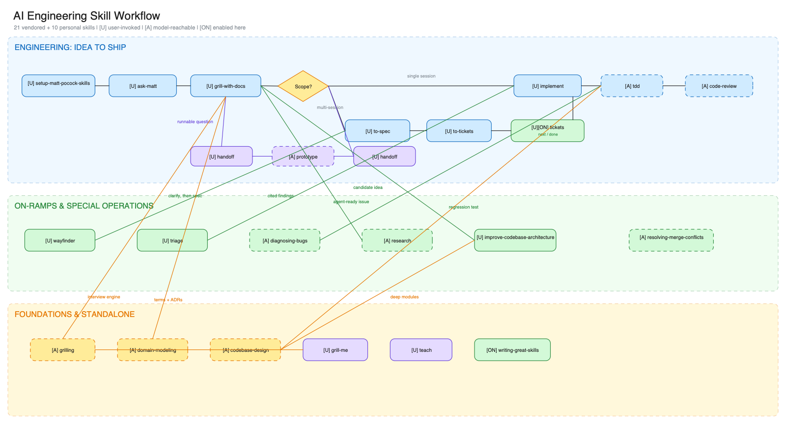

# peibin-skills

[English](./README.md) | [简体中文](./README.zh-CN.md)

一套为 Codex、Claude Code 和 Cursor 准备的、可复用的 AI 编码 Agent Skills 与工程工作流。

仓库按所有权清晰分层：

- `skills/personal/` 存放本仓库自行维护的 Skills。
- `skills/vendor/` 存放精选的第三方 Skills，并固定到有记录的上游 revision。
- [`.claude-plugin/plugin.json`](./.claude-plugin/plugin.json) 定义 Claude Code 插件默认启用的 Skills。

## 工程工作流

核心交付流程把需求、规划、实现、Ticket 状态、提交和 Pull Request 分成独立职责：

```text
$requirements-analysis -> discussion.md
        |
        v
   $why-this
        |
        v
$to-spec -> $in-your-own-words
        |
        v
   $why-this
        |
        v
$to-tickets
        |
        v
   $why-this -> $how-this
        |
        v
$implement -> $to-commits -> $to-pr
```

`$in-your-own-words` 用用户的语言复述目标和问题，让用户在建 Ticket 之前确认 spec 符合本意；`$why-this` 是用户主动调用的必要性检查，可在写完 discussion、spec 或 Ticket 后重新审视这项工作是否存在必要；`$to-tickets` 负责把 spec 拆成实现 Ticket；`$how-this` 在编码前审视实现方案、可复用代码和更优架构；`$implement` 负责实现、测试、代码审查和实现提交。

[](./docs/diagrams/skill-workflow.excalidraw)

[编辑 Excalidraw 源文件](./docs/diagrams/skill-workflow.excalidraw) · [查看 SVG](./docs/diagrams/skill-workflow.svg)

## Personal Skills

| Skill | 用途 | 使用场景 |
|---|---|---|
| [to-commits](./skills/personal/to-commits/) | 把未提交改动拆成聚焦的 Conventional Commits | 改动已经可以提交 |
| [to-pr](./skills/personal/to-pr/) | 根据已提交改动生成 PR 描述并创建 Pull Request | 分支已经可以进入审查 |
| [to-mermaid](./skills/personal/to-mermaid/) | 生成能在 Markdown 中稳定渲染的 Mermaid 图 | 路径或特殊字符让图表容易出错 |
| [to-feature-doc](./skills/personal/to-feature-doc/) | 根据真实实现为现有功能生成工程文档 | 模块需要设计说明或新人指南 |
| [explain-feature](./skills/personal/explain-feature/) | 跨 Ticket 用通俗语言讲解功能交付和实际实现 | 想了解一个功能做了什么、怎么运作、还有哪些缺口 |
| [requirements-analysis](./skills/personal/requirements-analysis/) | 逐项澄清 Feature，并持久保存讨论过程 | 需求仍然模糊 |
| [why-this](./skills/personal/why-this/) | 重新审视 discussion、spec 或 ticket 是否必要，并记录 keep/shrink/merge/defer/drop 结论 | 准备为规划产物投入精力之前 |
| [setup-engineering-workflow](./skills/personal/setup-engineering-workflow/) | 配置工程工作流，并根据实际命令、模块边界和约束完善项目指令 | 仓库准备采用这套工作流 |
| [implement](./skills/personal/implement/) | 在仓库配置的 worktree 中实现 spec 或 ticket | 已规划的工作可以开始实现 |
| [blueprint](./skills/personal/blueprint/) | 为 Feature 画出跨层详细架构图，并附简短图注 | Feature 需要一张全局蓝图图 |
| [how-this](./skills/personal/how-this/) | 在编码前审视 ticket 的实现方案、可复用代码和更优架构 | 正在决定 ticket 如何实现 |
| [handoff](./skills/personal/handoff/) | 使用 `$handoff` 生成可持久恢复的版本化 Markdown 交接物 | 工作需要在另一个会话继续 |
| [code-review](./skills/personal/code-review/) | 审查指定改动并报告有明确证据的回归 | 日常本地改动、commit、分支或 PR 需要审查 |
| [english-tutor](./skills/personal/english-tutor/) | 先用自然英文复述中文或有语法错误的英文消息，再执行任务 | 希望在完成任务的同时学习英语表达 |
| [init-flutter-app](./skills/personal/flutter/init-flutter-app/) | 从 `flutter-template` 初始化 Flutter 应用 | 创建新的 Flutter 项目 |
| [add-flutter-feature](./skills/personal/flutter/add-flutter-feature/) | 给 `flutter-template` 项目增加分层 Feature | 扩展已有 Flutter 应用 |
| [android-app-monitor](./skills/personal/android-app-monitor/) | 通过 ADB 采集 Android 内存、CPU、帧统计、日志和操作标记 | 手动操作 App 时排查性能问题 |

## Archived Skills / 归档 Skills

[`archive/`](./archive/) 下的 Skill 仅作参考保存，不再注册到插件，也不会由下方安装命令安装：`tickets` 和 `html-to-mobile-page`。

`setup-engineering-workflow` 改编自 [mattpocock/skills](https://github.com/mattpocock/skills) 的 `setup-matt-pocock-skills`，revision 为 `2ab958093e83e0ec752e6c1c5932da465bf23e0c`。它保留上游 MIT 许可证，并增加了 Feature 文档和 worktree 配置。

## Vendor Skills

本仓库中的 [Matt Pocock Skills](./skills/vendor/mattpocock/) 是一个经过筛选的本地 fork。来源 revision 记录在 [`SOURCE.json`](./skills/vendor/mattpocock/SOURCE.json)，上游 MIT 许可证也保存在同一目录。

vendor 的 [pstack Skill](./skills/vendor/poteto/) `in-your-own-words` 复制自 [cursor/plugins](https://github.com/cursor/plugins)。来源 revision 记录在 [`SOURCE.json`](./skills/vendor/poteto/SOURCE.json)，上游 MIT 许可证也保存在同一目录。

Claude Code 插件当前启用了 vendor 工作流阶段 `grill-with-docs`、`to-spec`、`in-your-own-words`、`to-tickets` 和 `tdd`，以及 personal 的 `implement` 和 `code-review`。插件同时启用其他 personal 工作流 Skills，以及 `writing-great-skills`、`grilling` 和 `domain-modeling` 依赖。其他 vendor Skills 保留源码，但默认不加载。

personal 和 vendor 中都存在名为 `handoff` 和 `code-review` 的 Skill。personal 版本是 canonical 版本，也是插件中唯一注册的版本；vendor 版本仅作为参考源码保留。

`$handoff` 默认生成完整交接；高频续接可使用 `$handoff --compact`。两种档位都支持 artifact-only 输出：`$handoff --artifact-only` 和 `$handoff --compact --artifact-only`。

## 安装

使用已经配置 GitHub SSH 凭据的环境克隆私有仓库：

```bash
git clone git@github.com:ZhangPeibin/peibin-skills.git
cd peibin-skills
```

### Codex

把需要的 personal Skills 复制或软链接到共享的 Agent Skills 目录：

```bash
mkdir -p ~/.agents/skills
for src in \
  to-commits to-pr to-mermaid to-feature-doc explain-feature \
  requirements-analysis why-this setup-engineering-workflow implement blueprint how-this \
  handoff code-review english-tutor \
  flutter/init-flutter-app flutter/add-flutter-feature android-app-monitor
do
  ln -s "/path/to/peibin-skills/skills/personal/$src" ~/.agents/skills/"$(basename "$src")"
done
```

### Claude Code Plugin

通过 [`.claude-plugin/plugin.json`](./.claude-plugin/plugin.json) 将仓库作为 Claude Code 插件加载，即可一起启用所有已注册 Skills。

### Cursor

把需要的 personal Skills 复制或软链接到 Cursor Skills 目录：

```bash
mkdir -p ~/.cursor/skills
for src in \
  to-commits to-pr to-mermaid to-feature-doc explain-feature \
  requirements-analysis why-this setup-engineering-workflow implement blueprint how-this \
  handoff code-review english-tutor \
  flutter/init-flutter-app flutter/add-flutter-feature android-app-monitor
do
  ln -s "/path/to/peibin-skills/skills/personal/$src" ~/.cursor/skills/"$(basename "$src")"
done
```

### `npx skills`

直接安装 canonical 的 personal `handoff` 和 `code-review`，避免名称去重选择 vendor 副本：

```bash
npx skills add /path/to/peibin-skills/skills/personal/handoff --agent codex --copy -y
npx skills add /path/to/peibin-skills/skills/personal/code-review --agent codex --copy -y
```

不要通过仓库根目录的 `--full-depth` discovery 安装 `handoff` 或 `code-review`。installer 会按名称去重，因此其列表无法证明最终选择了哪个副本。根目录 discovery 仍适合安装没有同名冲突的明确 Skill。

安装主要工程工作流及其依赖：

```bash
npx skills add /path/to/peibin-skills --full-depth --skill setup-engineering-workflow requirements-analysis grill-with-docs to-spec in-your-own-words to-tickets why-this how-this implement tdd grilling domain-modeling
```

installer 可能在消费项目中创建或更新 `skills-lock.json`；本源码仓库不维护该锁文件。

## 开发与验证

运行与 CI 完全相同的隔离检查：

```bash
uv run --isolated --no-project --no-config --no-env-file --with PyYAML==6.0.2 -- python3 -I scripts/check.py
```

检查会验证插件注册、Skill metadata、本地文档链接、workflow 资产，以及所有 personal Skill 测试。本地直接运行 `make check` 也会执行同一个入口。

## 仓库结构

```text
peibin-skills/
├── .claude-plugin/
│   └── plugin.json
├── .github/workflows/ci.yml
├── docs/diagrams/
├── scripts/check.py
├── scripts/validate_repo.py
├── skills/
│   ├── personal/
│   └── vendor/mattpocock/
├── README.md
├── README.zh-CN.md
└── Makefile
```

## 添加 Skill

1. 在 `skills/personal/` 下创建目录，例如 `skills/personal/my-skill/`。
2. 添加带有 `name` 和 `description` frontmatter 的 `SKILL.md`。
3. 添加 `agents/openai.yaml`；显式调用的 Skill 应设置 `allow_implicit_invocation: false`。
4. 在 [`.claude-plugin/plugin.json`](./.claude-plugin/plugin.json) 中注册路径。
5. 同时更新两份 README。

第三方 Skills 应放在 `skills/vendor/<owner>/` 下，同时保留许可证，并记录上游仓库和准确 revision。

## License

[MIT](./LICENSE)
