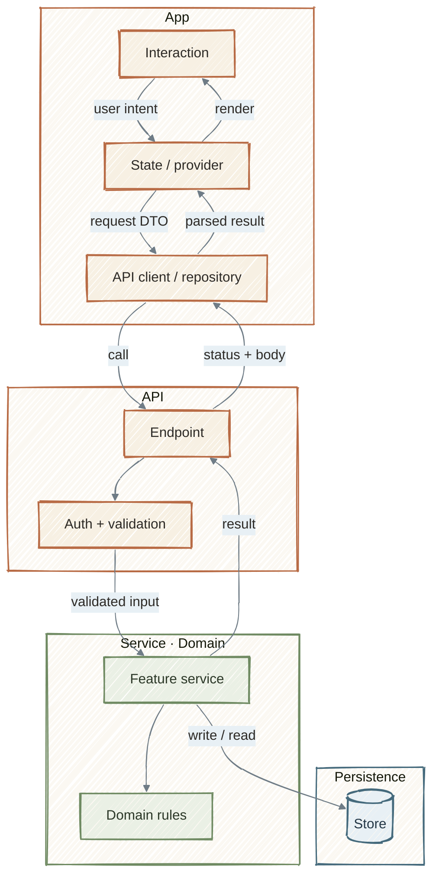

# Feature Blueprint: <feature name>

<At most five lines: who triggers it and from where; the user-visible outcome; the
key contract; failure and idempotency behavior; non-goals.>

Replace the sample with the real flow. Delete layers and boxes that do not apply,
and add optional `AI`, `Async`, or `Media` subgraphs only when they exist. Use
`references/diagram-style.md` and `to-mermaid` for labels with paths or symbols.

Add a second sequence diagram only when order, retries, or async handoff cannot be
read from the flowchart. Do not add section headings, long tables, or a written
walkthrough.
