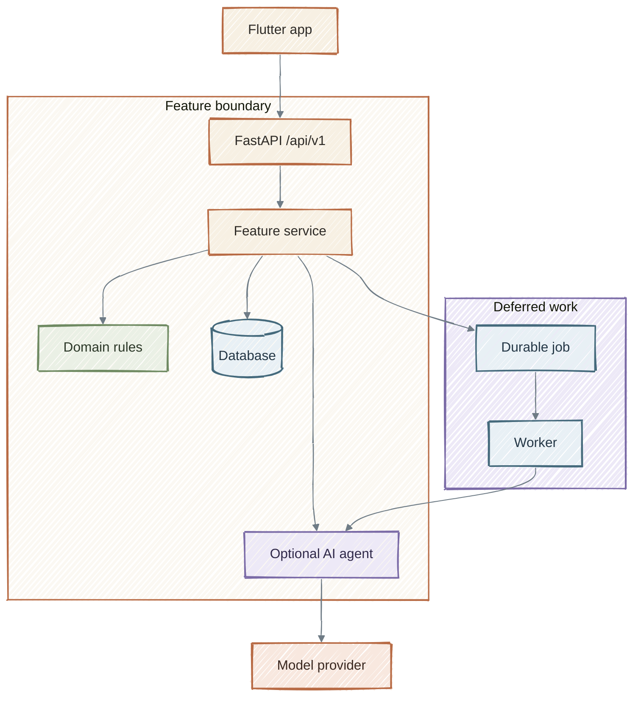
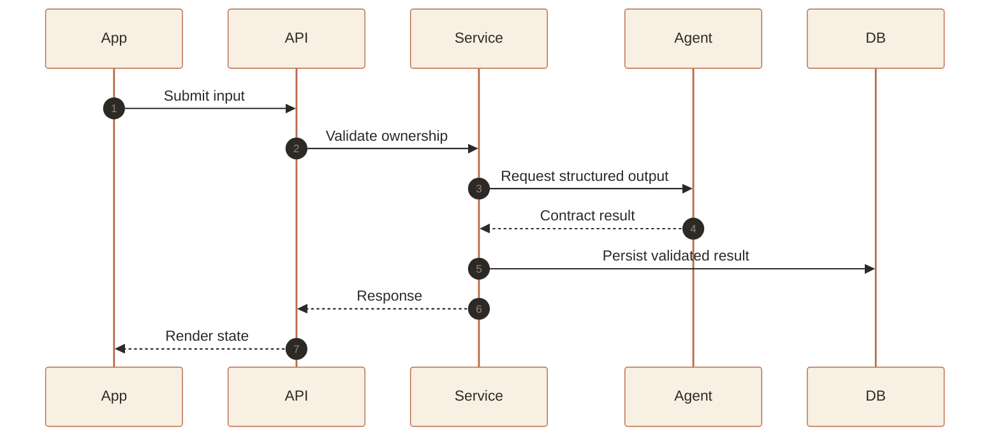

# Diagram style

Use this visual language for architecture blueprints and repository docs. It is
deliberately warm, hand-drawn, and layered, so the diagram reads as a product
architecture rather than a generic dependency graph.

Follow the `to-mermaid` skill for syntax and fragile labels. Keep each diagram
focused on one structural view or one ordered flow.

## Blueprint default

A blueprint is one detailed panorama diagram, not a document. Default structure:

- layer with subgraphs named App, API, Service + Domain, AI, Data, Async, Media;
- include only the layers the feature actually uses;
- put the real call, payload, error code, or data on every arrow;
- use cylinders for stores and rounded rectangles for components;
- show synchronous response and deferred work as visually separate regions;
- add a sequence diagram only when order, retries, or async handoff is not legible
  in the flowchart.

A reader should be able to explain the feature from the diagram alone. Prose is a
short caption, not a walkthrough.

## Visual language

- Background: warm paper `#FBF8F2`.
- App and API: warm sandstone.
- Data, queue, worker, and storage: cool blue.
- Domain and context: sage.
- AI agents: lavender.
- Model, speech, and external providers: peach.
- Use rounded rectangles for components, cylinders for databases, and labeled
  arrows. Put the layer name on each subgraph.
- Give every diagram a short caption. The diagram carries the explanation; prose
  only frames what the reader should see.

## Flowchart template

Delete optional agents and async boxes when the feature does not need them. The
diagram must show the actual shape, not a maximal architecture.

## Sequence template

Use a sequence diagram when order, retries, or async handoff matter:

## Quality checks

- The diagram and the implementation name the same components.
- Every arrow represents a real call, event, or data flow.
- Every arrow is labeled with the payload, result, or error that crosses it.
- Async work is visibly separate from the synchronous response.
- Optional components are absent when unused; the diagram is not a maximal
  architecture.
- Every required layer appears: app, API, service/domain, data, and any real AI,
  async, or media boundary.
- The diagram alone is enough to explain trigger, success, failure, and ownership.
- Subgraph labels describe ownership, not decoration.
- No component appears in two ownership layers without a reason.
- The prose states what the reader should learn from the diagram and stays short.
