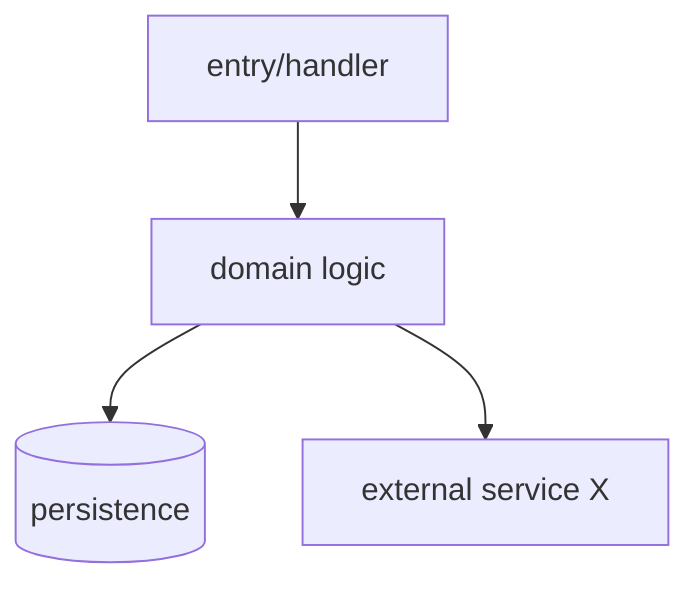
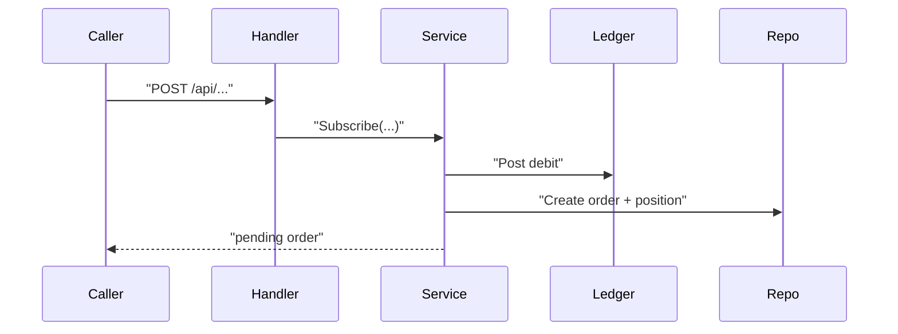

# <Feature name>

<One-sentence summary of what this feature is and who/what uses it.>

## Purpose

Why this feature exists and what problem it solves. Include:

- The **user or system outcome** (not just "exposes an API").
- **In scope / out of scope** — what this module owns vs what it delegates to neighbours.
- Enough background that the rest of the doc makes sense without prior context.

## Mental model

How a newcomer should think about this feature before diving into files — the core abstraction and main moving parts. Plain language; file paths optional here.

### Invariants

List invariants that hold across flows. Each row must be **expanded later** in Core behaviour (use **Details** to point at the subsection).

| Type | Invariant | What it guarantees | Details |
| ---- | --------- | ------------------ | ------- |
| Concurrency | e.g. idempotency key, row locks | | §<flow> |
| Accounting | e.g. unit-price continuity, conservation of shares | | §<flow> → Consistency statement |
| Temporal / ordering | e.g. settlement step order, T+1 boundary | | §<flow> |

Skip types that don't apply. For financial/settlement modules, **Accounting** and **Concurrency** rows are required unless explicitly N/A.

## Domain concepts

| Term / entity | Meaning in this feature | Primary code / storage |
| ------------- | ----------------------- | ---------------------- |
| `<term>` | <definition grounded in code> | `path/to/types.ts` or table `foo` |

Skip this section only if the feature has no domain vocabulary beyond generic CRUD.

## Architecture

Narrative first: the components, layers, and dependency directions. Answer **who owns what** and **what must not import what**.

Include a component/layer diagram when the module has multiple moving parts:

## Core behaviour

Describe the **main behaviours** as prose: triggers, inputs, outputs, side effects, and important branches. Cover at least:

1. **Primary flow** — the path a newcomer will debug first.
2. **Secondary flows** — batch jobs, webhooks, admin paths, migrations, etc., if they exist.
3. **State & lifecycle** — what gets created/updated/deleted, and when; note idempotency or concurrency if relevant.
4. **Error & edge cases** — validation failures, retries, partial failure, "silent" defaults.

For each **major flow** (subscribe, redeem, settlement, sync, etc.), add a short prose summary **and** a `sequenceDiagram` showing the API/service call chain when ordering matters:

Repeat per major flow — one diagram per subsection is fine. Follow **to-mermaid** for paths and route labels.

For **settlement, pricing, ledger, or balance** flows, add a subsection after the flow description:

#### Consistency statement

- **Formula / unit price calculation** — numerator, denominator, which shares or balances are included (e.g. does `total_shares` include redeeming at yield time?).
- **What invariant this preserves** — which invariant this step maintains; how it connects to the previous/next step.
- **Exceptions / simplifications** — clamps, zero floors, or `(inferred)` shortcuts in code.

Link back to the matching row in **Mental model → Invariants**.

## Interfaces

### Entry points

How other code or users invoke this feature — handlers, CLI, queue consumers, public SDK methods. For each, note auth expectations and sync vs async.

### Data

Key types, tables, or message shapes. Mention relationships and which layer owns validation.

### Configuration

Env vars, feature flags, or settings that change behaviour — include defaults and what breaks if misconfigured.

## Dependencies

| Dependency | Role | How this feature uses it |
| ---------- | ---- | ------------------------ |
| `<module or service>` | <why it's needed> | `path/to/call/site` |

Include internal modules (neighbours) and external systems. This is not a full architecture doc for those dependencies — one row each is enough.

## Key files

| File | Responsibility |
| ---- | -------------- |
| `path/to/entry.ts` | <what a newcomer looks here for> |
| `path/to/core.ts` | <...> |

Order by **onboarding value** (entry → core → persistence → tests), not alphabetically.

## Testing & local development

How to verify behaviour locally: relevant test files, fixtures, `make` targets, or manual smoke steps found in the repo. If tests are thin or missing, say so — don't invent a workflow.

## Design decisions & gotchas

- **Decision** — the choice made and its reason (cite the ADR/commit if found; mark `(inferred)` otherwise).
- **Gotcha** — a trap, non-obvious constraint, or known rough edge.

## Related reading

Links or paths to ADRs, parent design docs, or adjacent modules a reader should open next. Omit if none exist.
