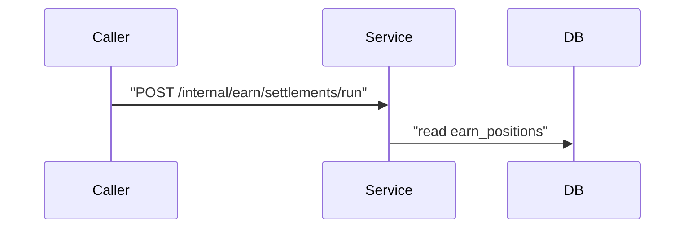
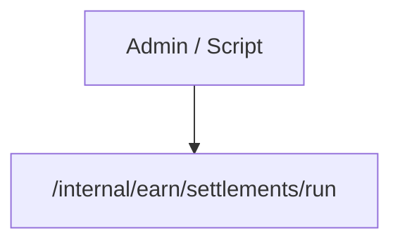
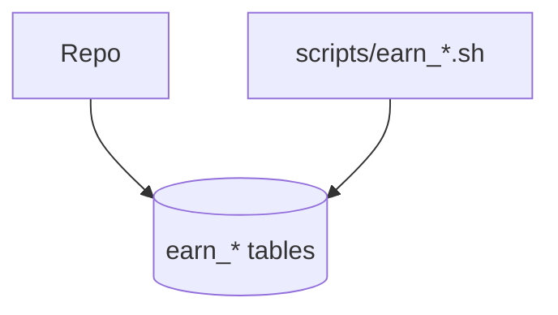

# To-Mermaid

Write Mermaid diagrams that **render without parse errors**. The most common failure is unquoted node labels that contain `/`, `*`, or other characters Mermaid treats as syntax.

## Core rule

**Quote any node or message label that contains special characters.**

Use double quotes inside the brackets:

```
id["label text here"]
```

When in doubt, quote. A quoted label never breaks the parser.

## Characters that require quoting

Quote the label if it contains any of:

| Character | Why |
| --------- | --- |
| `/` | Triggers parallelogram shape `[/text/]`; leading `/` is especially dangerous |
| `*` | Wildcard; confuses some renderers |
| `.` | Dots in paths like `service.go` |
| `(` `)` | Conflicts with shape syntax like `[(database)]` |
| `[` `]` | Nested bracket ambiguity |
| `#` `;` | Statement / comment delimiters in some parsers |
| `@` | Used in some Mermaid directives |

Plain words with spaces are usually fine unquoted: `A[Core logic]`. File paths, URLs, and API routes are **not** — always quote those.

## Flowchart shapes with quoted labels

| Shape | Syntax | Example |
| ----- | ------ | ------- |
| Rectangle | `id["text"]` | `Handler["internal/handler/earn.go"]` |
| Rounded | `id("text")` | `API("POST /users")` — quote if `/` present: `API["POST /users"]` |
| Database / cylinder | `id[("text")]` | `DB[("earn_* tables")]` |
| Stadium | `id(["text"])` | `Cache(["redis:6379"])` |

**Parallelogram trap:** `[/text/]` is a shape, not a quoted path. Never write:

```
BAD:  InternalAPI[/internal/earn/settlements/run]
GOOD: InternalAPI["/internal/earn/settlements/run"]
```

## Sequence diagrams

Quote message text that contains `/`, `*`, or other special characters:



Arrow labels with only plain words need no quotes: `Caller->>Service: request`.

## Good / bad examples

**Bad** — parse error (parallelogram + unclosed `/`):

```mermaid
flowchart TD
  Admin[Admin / Script] --> InternalAPI[/internal/earn/settlements/run]
```

**Good:**



**Bad** — `*` and `/` in unquoted labels:



**Good:**


## Before finishing

1. Scan every node label for `/`, `*`, `.`, `(`, `)`. Quote any that have them.
2. Check no label starts with `[/` unless you intentionally want a parallelogram **and** close it with `/]`.
3. Keep diagrams small — a newcomer should grasp them at a glance.
