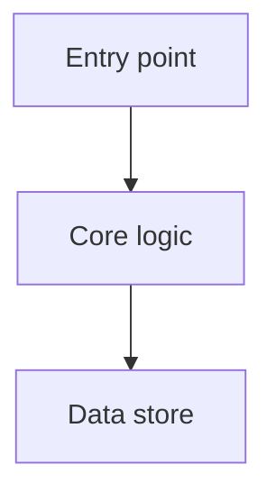
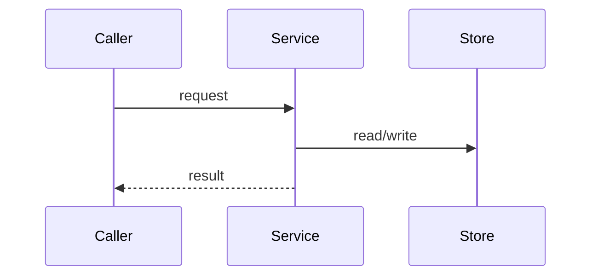

# To-Feature-Doc

Produce a single Markdown document that orients a **new engineer** around one existing feature or module — what it's for, how it's put together, how data flows, and where to look. The document describes what the code **is today**, grounded in the source: you read the code first, and every claim points at a real file a newcomer can open.

The defining constraint: you never document from memory of similar systems. If it isn't in the code (or git history, comments, ADRs), it doesn't go in the doc — and anything you infer is marked as inferred.

## Before you start

Pin down three things (ask the user if unclear):

- **Language** - default to **Chinese**; switch to the repo's docs language if there's an existing docs convention in another language.
- **Scope** — which feature, and its entry points / directories. The boundary decides what's in scope; state it explicitly.
- **Output path** — where the doc is written. Default to `docs/<feature>.md` in the target repo, or beside the module; follow the repo's existing docs convention if one exists.
- **Audience** — a new engineer with general skills but no context on this feature. Write for someone who will navigate the code, not just read prose.

## Workflow

Copy this checklist and track progress:

```
- [ ] 1. Scope: pin down entry points and boundaries
- [ ] 2. Read: trace the core flow from entry point to output
- [ ] 3. Architecture: identify components and how they relate
- [ ] 4. Interfaces: external API, data models, config
- [ ] 5. Key files: map each important file to its responsibility
- [ ] 6. Decisions & gotchas: recover the why (git log, comments, ADRs)
- [ ] 7. Write the doc from the template
- [ ] 8. Verify: every file path and claim checks out against the code
```

Do the reading (steps 1–6) before writing (step 7). Don't interleave — a half-read feature produces a doc that quietly invents the other half.

## Grounding rules

- **Read before you write.** Open the actual files and trace the actual flow. Never fill gaps with how a system like this "usually" works.
- **Cite real paths**, relative to the repo root, so a newcomer can click through. Prefer `path/to/file.ts:functionName` when a specific entry point matters.
- **Mark uncertainty.** Anything you deduce but can't confirm from the code gets `(inferred)`. Design rationale you can't derive — ask the user to confirm rather than guessing a reason.
- **Describe, don't editorialize.** Document what exists today. Known problems and sharp edges go in one **Gotchas** section, not sprinkled through as opinions.

## Document template

Fill this template. Keep each section to what the feature actually earns — drop a heading rather than pad it. (The template uses three-backtick fences for its own diagrams; the four-backtick fence below is only so the whole template shows here as one block.)

````markdown
# <Feature name>

<One-sentence summary of what this feature is.>

## Purpose

Why this feature exists and what problem it solves. The background a newcomer
needs to understand the rest.

## Architecture

The components this feature is made of and how they relate. Include a diagram:



## Core flows

The main path(s) through the feature, from trigger to result. Use a sequence
diagram for anything with meaningful ordering:



## Interfaces

- **External API / entry points** — how other code invokes this feature.
- **Data models** — the key types/tables and their shape.
- **Configuration** — env vars, flags, settings that change behaviour.

## Key files

| File | Responsibility |
| ---- | -------------- |
| `path/to/entry.ts` | <what a newcomer looks here for> |
| `path/to/core.ts` | <...> |

## Design decisions & gotchas

- **Decision** — the choice made and its reason (cite the ADR/commit if found;
  mark `(inferred)` otherwise).
- **Gotcha** — a trap, non-obvious constraint, or known rough edge.
````

## Diagrams

Use Mermaid, kept small — a diagram a newcomer can hold in their head beats an exhaustive one they'll skip. `flowchart` for architecture/component relationships; `sequenceDiagram` for ordered flows. Skip the diagram entirely if the feature is small enough that prose is clearer.

## Verify

Before finishing, re-check the doc against the code: every cited path exists, every entry point is real, and the flow you described matches what the code actually does. A doc a newcomer can't trust is worse than none.
